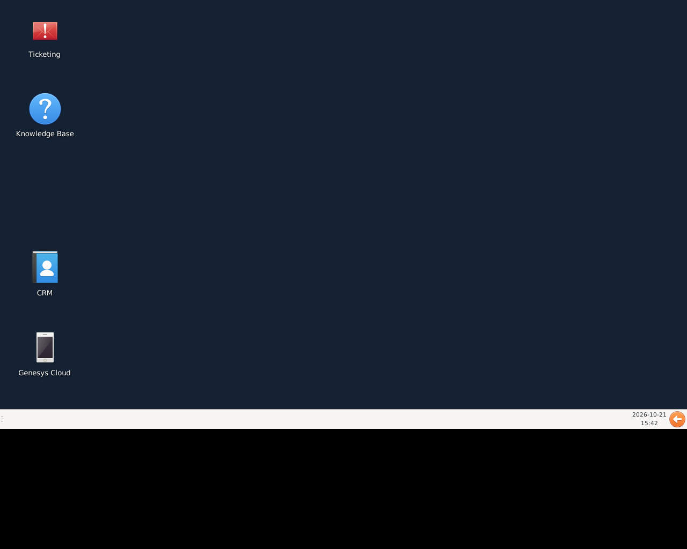
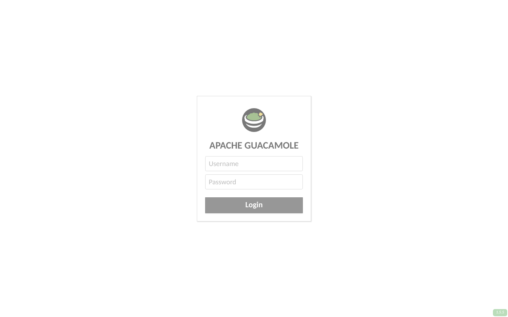
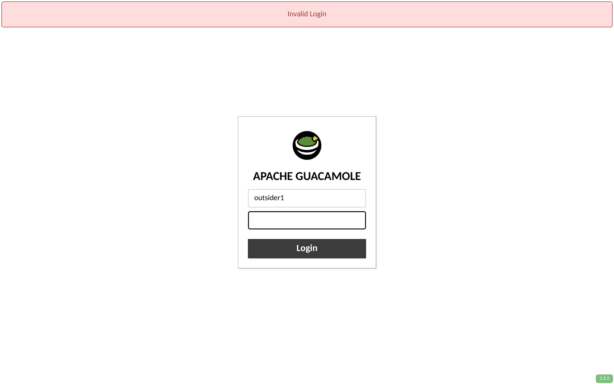
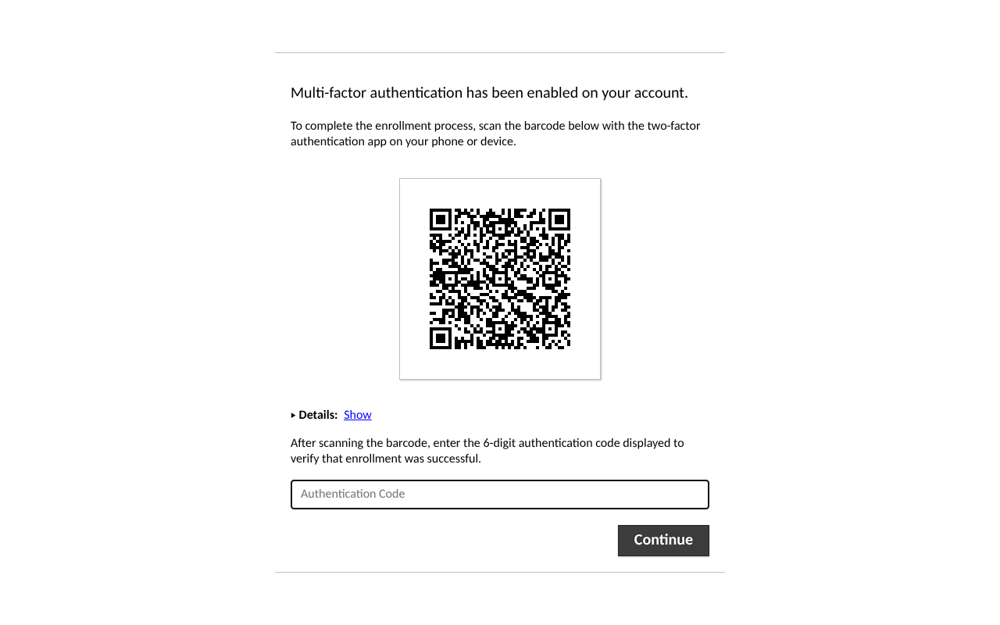

# Call-center thin-client lab: test kit

A test kit for the "Call Center Thin-Client & Remote Access Solution" design. It has three parts:

1. **A simulated lab** (`docker compose`). There is one container for every VM and test device in the
   design's lab table: AD domain controller, two xrdp session hosts, HAProxy, Guacamole with
   LDAP + TOTP, the DMZ nginx proxy with fail2ban, a WireGuard gateway, an office endpoint, a home
   endpoint, and a probe host on "the internet". You can test the whole design on one laptop
   before the Proxmox server exists.
2. **Ansible roles** that build the session hosts and the endpoint golden image. The roles
   that build the simulation also build the real lab (`ansible/inventories/lab`).
3. **An automated test suite** (pytest + testinfra), with one or more tests for each line of the lab
   checklist. It runs against the simulation by default, or against the real lab with
   `LAB_TARGETS=tests/targets/lab.yml`.

### Two ways to run the agents' laptops

| | **A. Windows laptops as viewers** ([`windows/`](windows/README.md)) | B. Linux thin endpoints (`ansible/roles/endpoint`) |
|---|---|---|
| Laptop | your current laptop and Windows image, AD-joined | Ubuntu image on mini PCs or reused laptops |
| What the agent sees | only the server desktop: Windows' own desktop is replaced | local desktop with Genesys in Chrome, plus RDP to the farm |
| Genesys | **desktop app** on the laptop, started and focused from an icon on the server desktop | web app in Chrome app mode on the endpoint |
| Login | AD once; the laptop gets a one-time ticket by Kerberos and opens the server desktop | AD on the endpoint, again for RDP |
| Web systems | server desktop: icon per system, Chrome with every system as a tab, server CPU/RAM | same session hosts |

Option A adds a small broker service (`services/cc_broker.py`) for the single sign-on and the
"open Genesys on my laptop" commands. Both options use the same session hosts, AD, portal and VPN.

The suite cannot judge calls, headsets or real hardware, so [`docs/MANUAL_TESTS.md`](docs/MANUAL_TESTS.md)
holds step-by-step manual tests and a results sheet for those. `tools/` has two scripts for the pilot
measures.

## Run it on your computer

You only need **Docker**: Docker Desktop on Windows 10/11 (WSL 2 backend) or macOS, or Docker Engine
with Compose v2 on Linux. Give Docker at least **8 GB of RAM** and about 15 GB of disk.
Ansible, Python and the test tools run inside a `controller` container, so nothing else is
installed on your computer.

```bash
git clone https://github.com/howsy/howsy.git
cd howsy/thin-client-lab
```

| | Windows (PowerShell) | macOS / Linux |
|---|---|---|
| Everything: start, configure, test (~15 min first time) | `powershell -ExecutionPolicy Bypass -File .\lab.ps1 all` | `./lab.sh all` |
| Start the lab | `.\lab.ps1 up` | `./lab.sh up` |
| Configure machines with Ansible | `.\lab.ps1 provision` | `./lab.sh provision` |
| Run all tests / skip slow ones | `.\lab.ps1 test` / `test-fast` | `./lab.sh test` / `test-fast` |
| Rebuild an endpoint from bare Ubuntu and re-test | `.\lab.ps1 golden-image` | `./lab.sh golden-image` |
| Show the URLs and logins | `.\lab.ps1 info` | `./lab.sh info` |
| Live view of what agent1's laptop is told to do | `.\lab.ps1 watch-laptop` | `./lab.sh watch-laptop` |
| Shell inside the controller | `.\lab.ps1 shell` | `./lab.sh shell` |
| Stop / delete everything | `.\lab.ps1 down` / `clean` | `./lab.sh down` / `clean` |

### Look around like an agent

Once `all` (or `up` then `provision`) has finished:

| What | How | Login |
|---|---|---|
| Remote portal (emergency / home browser access) | open **https://localhost:8443/** and accept the self-signed certificate warning | `agent1` / `Agent-Pass1!`, then scan the QR code with any authenticator app (Google/Microsoft Authenticator) |
| A user who must be refused | same page | `outsider1` / `Agent-Pass1!` (a real AD account outside `CC-Agents-Test`) |
| Session-host desktop, the way office endpoints open it | Remote Desktop (`mstsc` on Windows, Microsoft Remote Desktop on Mac, Remmina on Linux) to **localhost:13389** | `agent1` / `Agent-Pass1!` |
| Load balancer: which host each session went to | **http://localhost:8404/** | none |

**Watch the laptop react in real time:** run `./lab.sh watch-laptop` (`.\lab.ps1 watch-laptop`) in a
second terminal. It plays agent1's laptop. Then RDP to localhost:13389 as agent1 and double-click
**Genesys Cloud** on the desktop. The terminal prints `starting genesys`, and on a second click
`bring to front`. On a real Windows laptop, that's the moment the Genesys desktop app opens.

In the portal, click **CC Desktop** (the name, not the `+`) to get a load-balanced desktop. Copy/paste
in and out of the session is blocked on purpose. These ports listen on your computer only (127.0.0.1).

| Agent desktop (what the laptop shows) | Portal login | Outsider refused | TOTP enrolment |
|---|---|---|---|
|  |  |  |  |

The agent desktop has an icon per web system from the catalog (`tests/apps.sim.yml`) plus
**Genesys Cloud**, which opens on the laptop. There is one bar with open windows, clock and log out:
no apps menu, no terminal, no shutdown. With Chrome installed, the browser opens every system as a tab
with a "Call Center" bookmarks bar.

The endpoints have no screen in the simulation. Their configuration is checked by the tests, but you
can't see the agent's own Ubuntu desktop with the Genesys window. To see that, run the same playbook
against an Ubuntu Desktop 24.04 virtual machine (VirtualBox, Hyper-V) using `ansible/inventories/lab`.

### Good to know

- The machines keep their configuration until they are recreated. After `clean`, or after deleting a
  session host or endpoint, run `provision` again. Rejoining AD is handled.
- Lab-only passwords are in `.env`, which is created from `.env.example`. If the computer cannot reach
  `dl.google.com`, set `CHROME_INSTALL=false` there. Then only the "Chrome installed" test is
  skipped. On Apple Silicon (ARM) Chrome is skipped automatically, because Google ships Linux Chrome
  for x86-64 only.
- Tested on x86-64 Linux with Docker Engine. Windows and macOS use the same containers through
  Docker Desktop, but have not been run as part of this work. If a step fails there, the error from
  `lab.ps1` / `lab.sh` says which command failed.

## Checklist coverage

| Lab checklist item | Automated (sim and real lab) | Manual |
|---|---|---|
| AD login on endpoint, session host and portal; outsider refused | `test_01_identity` (PAM through SSSD on every host; session hosts use xrdp's own PAM stack), `test_05` RDP login via HAProxy gives an XFCE desktop and the outsider gets none, `test_08` portal login and outsider refused | P-2 |
| Password change and expired-password prompt | `test_02_password`: user flagged "must change at next logon" is prompted, changes the password, new password works and old one is refused | P-1, P-3, P-4 |
| Genesys Cloud web app in app mode | `test_03_genesys`: app-mode launcher, autostart, restarts if closed, mic/notification policy for Genesys, Genesys reachable from each endpoint | G-1 … G-9 |
| Headset audio office and home | `test_03` split tunnel: Genesys traffic from home does not use the VPN | H-1 … H-4, G-8 |
| Engage workflow | listed in the app inventory (`apps.lab.yml`), so reachability is tested | E-1 … E-3 |
| Every other app opens | `test_04_apps`: each app in the inventory, from each place it is used | A-1 |
| Same files and settings on either host | `test_05`: file written on sh-01 is read on sh-02; on the real lab also checks `/home` is an NFS mount | — |
| Session host failure → reconnect elsewhere | `test_06_failover`: reconnect returns to the *same running desktop*; power off that host and the user gets a desktop on the other; the failed host returns to service by itself | — |
| Home endpoint: VPN before login, internal apps | `test_07_home_vpn`: enabled at boot, ordered before `systemd-user-sessions`, live handshake, internal subnet via `wg0`, AD login from home, nothing internal reachable with the tunnel down (not even by routing to the gateway) | V-1 … V-3 |
| Portal: AD + MFA from outside, clipboard/file transfer blocked | `test_08_portal`: TOTP enrolment and login, wrong code refused, outsider refused, default `guacadmin` disabled, HTTP→HTTPS, TLS ≥ 1.2, HSTS, only 80/443 exposed, internal hosts unreachable from outside, copy/paste/drive/SFTP/printing off, desktop opens over the browser websocket and the session is recorded, brute force is rate-limited then banned by fail2ban | — |
| USB storage blocked, no admin rights | `test_09_endpoint_lockdown`: `usb-storage`/`uas` resolve to `/bin/false`, udisks mount denied by polkit, agent has no sudo, idle screen lock set and locked, Chrome policies (no downloads, DevTools, incognito, extensions) | U-1 … U-4, D-1 |
| Golden image deploys without manual steps | `lab.sh golden-image` (bare device → one playbook run → endpoint tests pass); `test_10`: re-running the image changes nothing | I-1 |
| Windows laptop as viewer (option A) | `test_11_viewer`: ticket needs Kerberos, refused outside the group, single-use and bound to its user, AD passwords never sent to the broker; laptop login opens the desktop with a ticket and Genesys starts on the laptop by itself; the session's Genesys icon brings it forward on the agent's own laptop only; only allow-listed apps; closing the desktop ends the laptop session; icon per catalog system, Chrome tabs/bookmarks, no terminal/shutdown for agents, per-user CPU/RAM cap | W-1 … W-9 |
| Pilot: call quality, login time, per-user sizing | `tools/genesys_call_quality.py` (MOS by group, from the Genesys Analytics API), `tools/sessionhost_usage.py` | L-1 … L-3 |

Last full run in the simulation, from a clean start with `lab.sh`: **96 passed, 0 failed, 7 skipped**
(17 of them are the Windows-viewer flow). The skips are the Chrome install check (×2, Chrome download
blocked in that environment) and five `lab_only` checks: NFS mount ×2, disk encryption, `lsmod` ×2.

## What the simulation does not prove

| Design component | In the simulation | Proven only in the real lab |
|---|---|---|
| Active Directory | Samba 4 AD DC | Windows DC specifics, GPOs, LDAP signing policy |
| files-01 (NFS) | shared Docker volume | NFS + Kerberos mount (`test_home_folders_come_from_the_file_server`) |
| HAProxy pair + keepalived | one HAProxy | VIP failover between the two balancers |
| Proxmox, PXE, Zabbix, backups | not simulated | I-1, and checking monitoring and backups by hand |
| Endpoint desktop (GNOME, GDM, Chrome UI, audio) | config and PAM level only | G-*, H-*, P-1, U-* |
| VPN | WireGuard (userspace) | the firewall VPN if that is used, MFA, real home links |

## Running against the real lab

1. Copy `ansible/inventories/lab/*.example`, `tests/targets/lab.yml.example` and `tests/apps.lab.yml.example`
   (drop `.example`) and fill in hostnames, AD names and the Genesys region.
2. `cd ansible && ansible-playbook -i inventories/lab/hosts.yml site.yml`
3. `LAB_TARGETS=tests/targets/lab.yml python3 -m pytest tests` (from a machine with the packages in
   `tests/requirements.txt`). The test machine needs key-based SSH with sudo to the hosts.
   The portal and exposure tests should run from outside the company network. `outside_host` in
   `lab.yml` points at such a machine.
4. Work through `docs/MANUAL_TESTS.md`.

The failover test powers a session host off through the `power_off` and `power_on` commands in `lab.yml`
(Proxmox `qm stop` / `qm start`), so run it outside working hours.

## Findings from building the lab (to feed back into the design)

1. **Pre-login VPN vs. MFA on the VPN conflict.** The design wants both. An interactive MFA prompt
   cannot appear before anyone has logged in. The usual fix is a device-authenticated tunnel
   before login (certificate or WireGuard key), with MFA kept on the portal and on user-level
   access. If the firewall VPN is used, check what its client supports for pre-logon (V-3).
2. **Sticky sessions must use the RDP username cookie, not the client IP.** Home users behind the
   VPN gateway's NAT, and office users behind NAT, share one source IP. With source-IP stickiness
   they would all land on one session host. `config/haproxy/haproxy.cfg` sticks on `mstshash` and
   uses `option redispatch`. `test_06` proves reconnect and failover with it.
3. **Guacamole needs its database, not only LDAP + TOTP.** TOTP keys for LDAP users are stored in
   the DB, so `POSTGRESQL_AUTO_CREATE_ACCOUNTS=true` is required. The default `guacadmin/guacadmin`
   account must be disabled. Both are done in `config/guacamole/002-seed.sql` and tested.
4. **fail2ban and rate limits must allow for how the Guacamole web app behaves.** Each TOTP login
   returns one 403 (the "enter code" step), and a wrong code returns 400, not 403. The web app also
   calls the login endpoint on every page load and token refresh. With a strict limit (10/min) real
   browsers got "An error has occurred"; API-only tests did not catch this. The proxy allows
   30/min (burst 20), and fail2ban bans after 10 failed attempts (400, 403 or 429).
5. **Guacamole → AD should use LDAPS.** The simulation uses plain LDAP. Production AD with LDAP
   signing/channel binding enforced will reject that, so plan LDAPS and import the AD CA into
   Guacamole's trust store.
6. **xrdp cannot enable clipboard or drives per AD group.** Channels are set per host in
   `xrdp.ini`. "Enabled per group if needed" means a separate session-host pool for that group,
   or using per-connection settings in Guacamole.
7. **The xrdp audio module (`pulseaudio-module-xrdp`) is not packaged for Ubuntu 24.04.** It has to
   be built from source. This matters little because Genesys audio stays on the endpoint.
8. **Ubuntu 24.04 ships Chromium and Firefox only as snaps.** The roles install Google Chrome from
   Google's apt repository on both endpoints and session hosts (the session hosts need a browser for
   web apps too).
9. **Chrome policies cannot stop an agent closing the Genesys window.** Genesys runs as a systemd
   user service with its own Chrome profile and `Restart=always`, so it comes straight back (G-2).
10. **Blocking usb-storage does not cover phones (MTP).** It also has to go into the initramfs, which
    the role does. Consider USBGuard with an allow-list of headset models (U-1).
11. **Disk encryption on home endpoints needs an unlock decision.** A boot passphrase for every agent,
    TPM unlock or network unlock (D-1).
12. **Single sign-on into xrdp needs a helper.** xrdp has no NLA/Kerberos login, so a Windows
    laptop cannot pass its logon on to the session hosts by itself. The broker issues a one-time
    password after Kerberos authentication. `pam_exec` on the session hosts accepts it, and only
    passwords that look like tickets are ever sent to the broker.
13. **The Genesys Cloud desktop app exists only for Windows and macOS.** Using it means keeping
    Windows on the laptops, which is option A. The Linux endpoint (option B) has to use the web app.
14. **`realm join` is replaced by `adcli join` plus a templated `sssd.conf`** with
    `access_provider = simple`. That is what `realm join` + `realm permit -g` write, but it is
    repeatable from Ansible and needs no realmd or packagekit. SSSD shows AD group names in lower
    case (`cc-agents-test`). The group check still works, as `test_01` shows.

## Layout

```
lab.sh, lab.ps1           the commands to run on your computer (Linux/macOS, Windows)
docker-compose.yml        simulated lab (corp 10.10.0.0/24, internet 172.30.0.0/24)
images/                   dc (Samba AD), managed-node (bare Ubuntu + systemd + SSH), proxy, vpn-gw, probe,
                          controller (Ansible + tests)
config/                   haproxy.cfg, Guacamole seed SQL, sample internal app, Genesys stand-in
ansible/                  site.yml, roles (ad_member, session_host, chrome, endpoint, home_vpn), inventories
tests/                    pytest suite, targets/{sim.yml,lab.yml.example}, app inventories
docs/MANUAL_TESTS.md      manual test scripts and results sheet
docs/screenshots/         what the portal and desktop look like
services/                 cc-broker, session-host helpers, Linux reference laptop agent
windows/                  option A: CC-Shell.ps1, cc-shell.json, installer, Group Policy steps
tools/                    genesys_call_quality.py, sessionhost_usage.py
```
