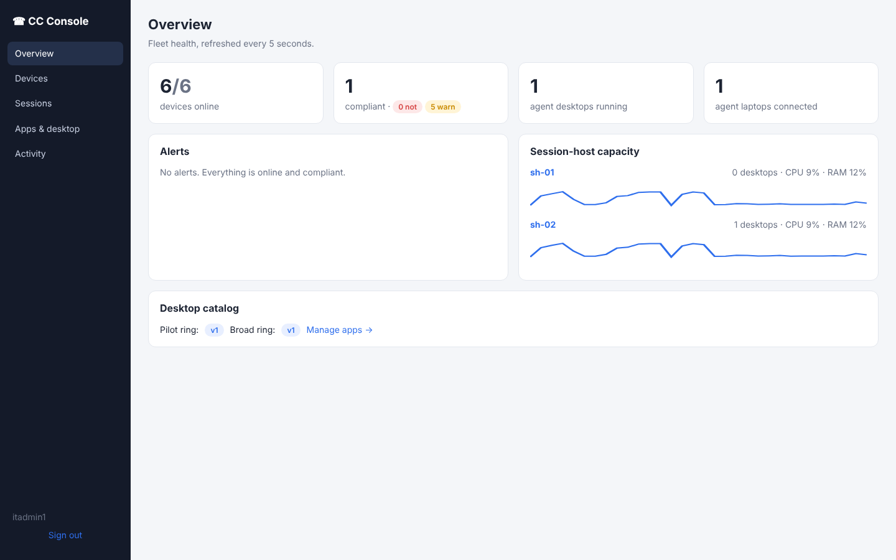
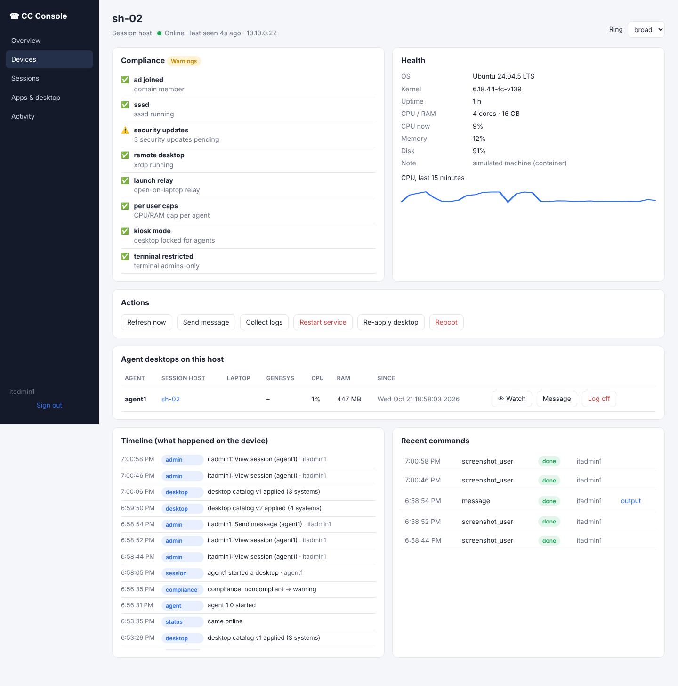
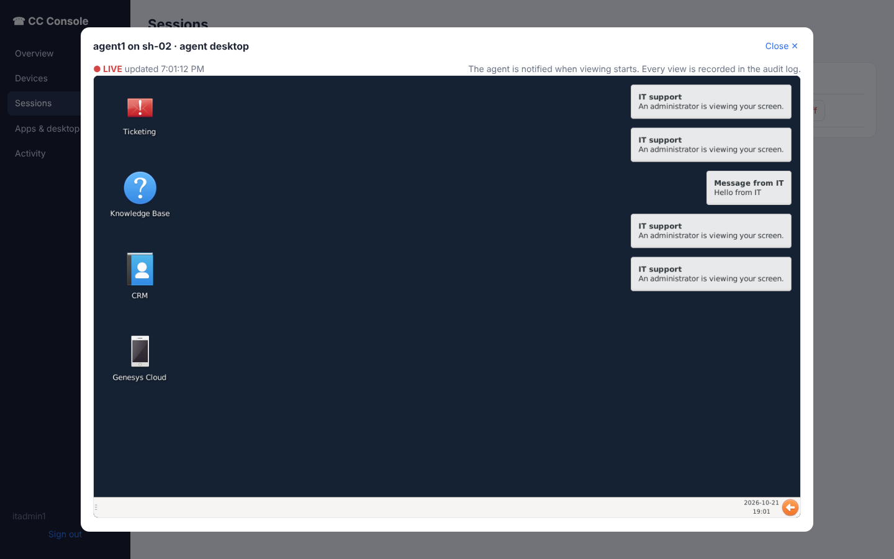

# Management console

One place to run the call-center fleet: every agent laptop, session host, endpoint and the broker.
It reports what each device is doing, checks that each one is set up correctly, and lets IT act on
it. In the lab it runs on `broker-01` and opens at **http://localhost:8090/**. Sign in with
`itadmin1` / `It-Admin-Pass1!` (admin; `itadmin2` is a second admin, `helpdesk1` / `Helpdesk-Pass1!` and `viewer1` / `Viewer-Pass1!` show the other roles). Only members of the IT groups can sign in.

| Overview | Device page | Live view of an agent's desktop |
|---|---|---|
|  |  |  |

## What it does, and where the ideas come from

| Feature | Console page | Borrowed from |
|---|---|---|
| Inventory: every device, its role, OS, user, health, last check-in | Devices | Intune device list |
| **Compliance checks** per device: AD-joined, SSSD, security updates; on session hosts xrdp, open-on-laptop relay, per-agent CPU/RAM caps, kiosk mode, terminal restricted, no data out (clipboard, drive and printer redirection off and clipboard refused both ways); on endpoints USB storage blocked, screen lock, browser policy, no admin rights, VPN, disk encryption. Failures make the device *Not compliant*; pending updates only warn. | Device → Compliance | Intune compliance policies |
| **Remote actions**: refresh, send message, collect logs, restart service, re-apply desktop, reboot; for laptops: start Genesys, reconnect desktop, sign out | Device → Actions | Intune remote actions |
| **See what happens on the device**: a live view of the agent's desktop or of the laptop screen (refreshed every 2 s), and a timeline of events (logged in, desktop opened, Genesys started, came online/offline, compliance changed, catalog applied, what admins did) | Device → View screen / Watch, Timeline | Intune Remote Help, device timeline |
| **Sessions**: every agent desktop on the farm, the laptop it is viewed from, Genesys running or not, CPU/RAM per agent; Watch, Message, Log off | Sessions | VDI session monitoring |
| **Apps & desktop**: the list of web systems on the agent desktop (one icon, one browser tab and one bookmark each); edit it in the browser, publish, and the session hosts update within ~15 s, including desktops already open | Apps & desktop | Intune app assignment |
| **Rings**: a published catalog goes to the *pilot* ring first; *Promote* sends it to *broad*. Every version is kept and can be rolled back with one click. | Apps & desktop | Intune update rings, SteamOS beta channel and A/B rollback |
| **Browser URL rules**: block listed sites (on top of the base lock-down) with exceptions, or *allow only* listed sites. In allow-only mode the desktop catalog's systems and Genesys are always allowed, so the agent desktop keeps working. Applies to Chrome on session hosts and Linux endpoints. | Policies | Intune / Chrome Enterprise URL blocklist |
| **Outbound firewall**: off, or *allow only* listed destinations (IP/CIDR, TCP/UDP, ports) for the agents' own apps. Root and system services (sign-in, home folders, updates, the console) are never filtered, so a wrong rule cannot cut a device off. | Policies | Intune firewall rules, Defender network protection |
| **Server resources per user**: CPU (100% = one core) and RAM caps for each agent's desktop on the session hosts, so one heavy user cannot slow the others; empty keeps the server default from Ansible. Applied as systemd user-slice limits, including to desktops already running. | Policies | VDI per-session resource limits |
| **Assignments for AD groups and users**: override the firewall (same as everyone + extra destinations, unrestricted, or allow-only) and the resource limits for an AD group or one user. A user assignment beats a group one; among groups the first listed wins. Members come from AD through SSSD, and users who sign in later pick up their group's rules within one check-in. URL rules stay machine-wide (Chrome on Linux only has machine policy). | Policies → Assignments | Intune assignment groups |
| **Policy rings**: policies are versioned and go pilot → broad with rollback, exactly like the catalog. Each device reports the version it applied, and a failure raises an alert. | Policies | Intune update rings |
| **Capacity**: CPU history per session host, desktops per host, alerts at high CPU/RAM | Overview | — |
| **Alerts**: offline servers (critical), offline devices, not-compliant devices, overloaded hosts | Overview | — |
| **Audit log** of every sign-in, action, screen view, publish, promote and rollback | Activity → Admin audit log | Intune audit logs |

## Privacy and safety

- When an admin starts watching an agent's desktop, the agent gets an on-screen notice: *"An
  administrator is viewing your screen."* Every view is in the audit log. Check this against your
  local rules and works-council agreements before the pilot.
- Devices only run actions from a fixed list (`ACTIONS` in `services/cc_console.py`). There is no
  "run any command" button. Services that can be restarted are allow-listed per role.
- **IT staff are limited too (least privilege, enforced by the server, not the browser).** Roles come from AD groups:
  | Role | AD group | Can |
  |---|---|---|
  | Read-only | CC-Viewers | see everything, change nothing |
  | Helpdesk | CC-Helpdesk | refresh, message, view a screen (the agent is told), start Genesys, reconnect, collect logs, re-apply desktop/policies |
  | Admin | CC-Admins | also log users off, sign out laptops, restart services, reboot, move rings, publish, promote, roll back |
  Every refused attempt is written to the audit log as *denied*. IT staff's own desktop sessions get the same policies and the same
  no-clipboard/no-drives rules as agents.
- **Two-person rule**: the admin who published a catalog or policy version cannot promote it to every device; a second admin must check
  and promote it (`console_four_eyes`). Rollback stays one click for any admin, so a bad change can be undone at once.
- **Idle sign-out** after 30 minutes without activity (`console_idle_minutes`), and at most 8 hours per sign-in.
- Admin sign-in is checked against AD (Kerberos) and those groups. The session is an
  HttpOnly, SameSite=Strict cookie, every change needs a CSRF header, and 5 failed sign-ins from an
  address lock it out for 5 minutes.
- Linux machines authenticate with an enrollment token. Laptops authenticate with the agent's own
  Kerberos ticket, so a laptop can never claim to be another user.
- Production: serve the console over HTTPS (`tls_cert`/`tls_key` in `console.json`), keep it on the
  internal network only, and keep the enrollment token in Ansible Vault.

## How it works

```
 session hosts, endpoints, broker            agent laptops (Windows: CC-Shell.ps1)
   cc-device-agent (root, every 15 s)           check-in with Kerberos as the agent
          │  health, compliance, sessions,              │  desktop open?, Genesys running?,
          │  events; waits for commands                 │  events; waits for commands
          ▼                                             ▼
                cc-console  (broker-01:8090, SQLite)  ◀── admins in a browser (AD sign-in)
                  devices · events · commands · catalog versions · rings · audit
```

- `services/cc_console.py` is the server and API. `services/console-ui/` is the web app (no
  internet needed).
- `services/cc-device-agent.py` runs on Linux machines. On session hosts it also applies the catalog
  for its ring with `cc-desktop-render`.
- Policies on session hosts and endpoints: URL rules go into an extra Chrome managed-policy file,
  `cc-urls.json`. Chrome applies the file that sorts last when two files set the same policy, so this
  one carries the base `URLBlocklist` from `cc-policy.json` plus the console's rules. The firewall is
  an nftables table, `inet cc_policy`, that only matches sockets owned by uid ≥ 1000 (agents). The last
  policy is kept in `/etc/cc-console/policy.json` and re-applied at boot.
- `services/cc-laptop-agent.py` (the lab's stand-in laptop) and `windows/CC-Shell.ps1` (real laptops)
  report as role *laptop*.
- Ansible roles: `console` (on brokers) and `device_agent` (everywhere else).

## What it does not replace

For the **Windows laptops' own operating system**, use Microsoft Intune (or your current tool such
as SCCM) if you have it. That covers Windows Update rings, BitLocker escrow, Defender, the Genesys
app installation and Autopilot. This console doesn't touch the Windows OS. It manages the
call-center layer on top: who is working where, the agent desktop, the farm, and support. The
laptop shell reports only while an agent is logged in. For laptops that are switched on but logged
out, Intune or a small SYSTEM-level agent is needed.

The Linux side (session hosts, broker, Linux endpoints) is fully covered by this console plus
Ansible.

## Tests

`tests/test_12_console.py` checks all of the above in the simulated lab:
- only CC-Admins can sign in; the CSRF header is required; bad device tokens are refused
- every machine reports, and the servers are compliant
- sessions are linked to laptops
- watching an agent desktop and the laptop screen returns real screenshots, and the view is audited
- message and Start Genesys work
- the timeline is filled
- only allow-listed actions run
- log off works
- pilot → promote → rollback changes exactly the right hosts
- viewers can only read, helpdesk cannot reboot, log off or change configuration, and refusals are audited
- the admin who published a version cannot promote it; a second admin can

`tests/test_14_policies.py` checks the policies:
- bad input is refused (host names instead of IPs, bad ports, allow-only with no rules, bad URL patterns), and the CSRF header is required
- session hosts and endpoints report the policy version they applied
- a URL rule and an allow-only firewall reach the pilot host first. The agent user is blocked from
  LDAP but can still reach the allowed CRM. Root and SSSD keep working. The broad host changes only
  after Promote, and rollback removes the firewall everywhere.
- allow-only URLs keep every catalog system and Genesys allowed
- assignments are validated; a user assignment (allow-only to the CRM) blocks only that user, while the group's RAM/CPU limit reaches the
  group's other members and the user assignment wins over the group; rollback restores the server defaults
